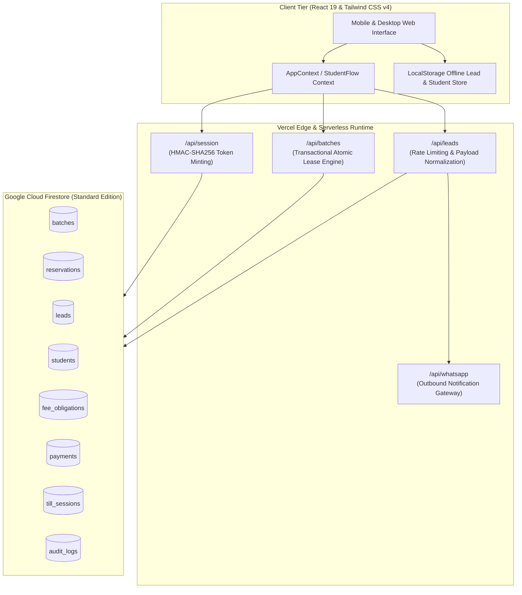

# Focus Academy — System Architecture & Data Flow

**Document ID:** FA-ARCH-2026.1  
**Target:** Edge CDN, Vercel Serverless Functions, React 19 Client Hydration, Cloud Firestore  

---

## 1. High-Level Architectural Model

The application adopts a decoupled client-centric Jamstack architecture optimized for low-bandwidth mobile networks and edge caching.

---

## 2. Core Subsystems

### 2.1 Navigation & Layout Mechanics
- **Sticky Navbar:** Positioned using `sticky top-0 z-50 w-full` with elevation (`isScrolled` trigger at >20px vertical scroll). No `relative` or `overflow-x-hidden` styles on parent containers to ensure position stickiness never breaks in CSS cascade.
- **Mobile QuickBar:** Fixed thumb-zone dock (`fixed bottom-0 z-40`) featuring 48px touch targets, safe-area inset padding (`pb-[calc(0.5rem+env(safe-area-inset-bottom,0px))]`), and one-tap telephony/WhatsApp invocation.

### 2.2 Admission Funnel & Step Session Engine
- Multi-step funnel state is persisted in both `sessionStorage` and `localStorage` under `focus_academy_student_flow`.
- Moving through Steps 1 to 5 triggers serverless sync (`/api/session`), where a cryptographically signed HMAC token (`mintToken(applicationId, step)`) is issued.
- Seat reservation (`/api/batches`) and lead enrollment (`/api/leads`) require valid step tokens verifying the visitor legitimately completed all antecedent steps.

### 2.3 Sibling Composite Isolation Engine
- Sibling multi-enrollment isolation ensures multiple children enrolled by the same parent phone number are preserved as distinct records.
- Records are identified by composite keys (`phone + studentName.toLowerCase().trim()`). Updating or restoring records for one sibling never overwrites or clears records for another sibling.

### 2.4 Transactional Seat Lease Engine
- Enforces the 1:12 small-batch capacity policy.
- Online seat reservations run in a Firestore atomic transaction:
  1. Reads batch capacity (default 12) and active leases.
  2. If capacity is exhausted, rejects double allocation and offers waitlist placement.
  3. If capacity is available, creates a 15-minute lease lock with an idempotency key (`${applicationId}__${batchId}`).
  4. Subsequent clicks by the same user return the existing reservation ID without decrementing extra seats.

### 2.5 Offline Lead Queue & Network Resilience
- `LeadService.submitLead` checks `navigator.onLine`.
- If offline, or if the serverless endpoint times out (>5000ms), the inquiry is stored in `focus_academy_pending_leads_v1` in `localStorage`.
- When network connectivity returns, a global `window.addEventListener('online')` handler flushes the queue sequentially, ensuring zero lost inquiries for rural 3G/4G users.

---

## 3. Data Schema & Collection Map

| Collection | Access Pattern | Security Enforcement | Primary Purpose |
| :--- | :--- | :--- | :--- |
| `batches` | Public Read, Admin Write | Public read; write restricted to `isAdministrator()` | Academic batches, timings, and capacity limits. |
| `reservations` | Server-only Write, Admin Read | Client writes forbidden (`allow create: if false;`) | Active 15-minute seat leases. |
| `leads` | Server-only Write, Admin Read | Client writes forbidden; read/update restricted to admin | Inquiries captured from website forms. |
| `students` | Admin Read/Write | Restricted to `isAdministrator()`; deletes forbidden | Enrolled student registry and academic history. |
| `fee_obligations`| Admin & Fee Manager Read/Write | Restricted to `isFeeManager()` | Monthly/quarterly fee schedules and pending balances. |
| `payments` | Admin & Fee Manager Read/Write | Validated schema; append-only; reversal via audit fields | Financial payment ledger and receipt records. |
| `till_sessions` | Admin & Fee Manager Read/Write | Restricted to `isFeeManager()`; deletes forbidden | Daily campus cash till opening, counting & closing. |
| `audit_logs` | Admin Read, System Append | Append-only; updates and deletes forbidden | Immutable audit trail for all campus operations. |
