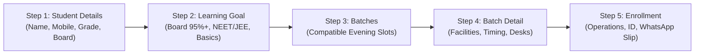

# Focus Academy — Product Requirements

## Billing & Due-Date Policy (authoritative)

- Tuition is billed per cycle with a default frequency of **monthly** (`student.feeConfig.billingFrequency` may be `monthly`, `quarterly`, `half-yearly` or `yearly`).
- The billing anchor is the **5th of the month in Asia/Kolkata**. A student enrolled on or before the 5th is billed for that month; a student enrolled after the 5th starts with the following month.
- The next due date is derived from the **last settled billing period**, preserving the anchor day and advancing by the configured frequency. A payment does **not** reset the due date to “payment date + 30 days”.
- `amountDue` is the charge for the cycle. The ledger invariant is:
  `outstanding = max(0, sum(amountDue) − sum(valid payments) − sum(approved waivers))`.
- Reversed or refunded transactions are excluded from collections. A waiver reduces the obligation but is never counted as cash collected.
- If no billing cycle or due date exists, the UI must show “Not scheduled” rather than inventing a date.
- Payments are collected at the campus desk (cash, UPI, bank transfer, card, cheque, demand draft). No online payment gateway is part of this workflow; a non-cash collection requires a transaction reference. & Acceptance Criteria

**Document ID:** FA-REQ-2026.1  
**Project:** Focus Academy Educational Coaching Institute  
**Target Region:** Thoramangalam, Perambalur, Tamil Nadu – 621220  

---

## 1. Academic Scope & Institutional Policy

| Requirement Area | Specification | Acceptance Criteria |
| :--- | :--- | :--- |
| **Grades Catered** | Primary Foundations (Classes 1–5), Middle School (Classes 6–8), High School & Senior STEM (Classes 9–12) | System accurately categorizes batches and tracks curriculum streams for all supported grade levels. |
| **Curriculum Boards** | Tamil Nadu State Board (Samacheer Kalvi), CBSE (NCERT), ICSE / ISC | Course discovery and batch enrollment enforces strict board alignment; no curriculum mismatch allowed. |
| **Small Batch Policy** | Strictly capped 1:12 teacher-student ratio | UI communicates the 12-student capacity limit; live booking enforces atomic lease locks and prevents over-allocation. |
| **Trial Guarantee** | 1-Day Free Trial (No Advance Deposit) | Parents can book an evening session trial without entering payment information or credit card numbers. |
| **Evening Schedule** | Mon–Sat: 4:00 PM – 9:00 PM • Slot 1: 4:30 PM – 6:00 PM • Slot 2: 6:00 PM – 7:30 PM • Slot 3: 7:30 PM – 9:00 PM | Timetable schedules are consistent across homepage, timetable view, and admission booking. |
| **Sunday Operations** | Closed for regular lectures; mock review & doubt clearance by appointment | Sunday policy is prominently displayed on contact cards and footer notes. |

---

## 2. 5-Step Admission Funnel Requirements

### Step 1 — Student Details & Login (`/student-details`)
- **R1.1:** Must collect Student Name, Parent/Guardian Name, 10-digit Indian Mobile Number, Education Board, and Grade.
- **R1.2:** Must validate mobile numbers against Indian telecom formats (`^[6-9]\d{9}$`).
- **R1.3:** Returning families must be able to restore prior grade and board preferences by entering their registered phone number.
- **R1.4:** Sibling registrations under the same parent phone number must be isolated using composite keys (`phone + studentName`).

### Step 2 — Learning Goal Calibration (`/exam-prep`)
- **R2.1:** Visitors must have completed Step 1; direct access redirects to `/student-details` with an informative banner.
- **R2.2:** Must offer distinct academic tracks based on grade level (SSLC Board 95%+, HSC Centum Focus, NEET/JEE Foundation, Conceptual Clarity).

### Step 3 — Batch Discovery & Timetable (`/batches`)
- **R3.1:** Must filter batches dynamically according to the student's selected grade and board.
- **R3.2:** Must display verified batch capacity (Max 12 Students) and current enrollment status without fabricating fake urgency timers.
- **R3.3:** Direct navigation to `/timings` must provide a public reference schedule without enforcing admission funnel step progression.

### Step 4 — Batch Detail View (`/batch/:batchId`)
- **R4.1:** Must show detailed breakdown of curriculum syllabus, weekly Saturday mock exams, study materials, and classroom amenities.
- **R4.2:** Must present an Academic Invariant Warning if the selected batch does not match the student's registered grade or board.

### Step 5 — Enrollment Inquiry & Confirmation (`/enroll`)
- **R5.1:** Collects operational inputs: School shift, dismissal time, transit duration to Thiripura Complex, and emergency contact.
- **R5.2:** Calculates schedule buffer automatically: Warns the parent if school dismissal + travel time results in a clash with batch start time.
- **R5.3:** Idempotent submission: Prevents accidental double submissions within 30 seconds.
- **R5.4:** Offline resilience: Inquiries submitted while offline are queued in `localStorage` and automatically synced when the network returns.
- **R5.5:** Generates pre-formatted WhatsApp enrollment docket for immediate coordination with institute counselors (+91 98424 51220).

---

## 3. Tuition Fee Calculator Requirements (`/fees`)

- **R3.1 Formula:** Monthly Base Fee = `Hourly Rate × Weekly Class Hours × 4`.
  - Class 6–8: ₹180 / hr
  - Class 9–10: ₹220 / hr
  - Class 11–12: ₹280 / hr
  - NEET / JEE Foundation: ₹340 / hr
- **R3.2 Multipliers:**
  - Online Interactive: 10% discount (0.9 multiplier)
  - Sibling Concession: 15% discount for 2+ children (0.85 multiplier)
  - Quarterly Enrollment Package: 12% discount (0.88 multiplier)
- **R3.3 Disclaimer:** Must explicitly state that calculated figures are provisional estimates and include all study materials and weekly mock exams.

---

## 4. Administrative Portal Requirements (`/admin-portal`)

- **R4.1 Access Control:** Restrict sign-in strictly to allowlisted institutional email addresses with verified email status.
- **R4.2 POS Cash Till Sessions:** Support opening, tallying, denomination breakdown, expected cash reconciliation, variance calculation, and closing of campus cash drawers.
- **R4.3 Financial Ledger:** Record verified fee payments with auto-generated receipt numbers, PDF/print receipt views, and auditable reversal reasons.
- **R4.4 Audit Trail:** Log all administrative operations (payment recording, reversal, student edit, batch creation, till settlement) immutably.
