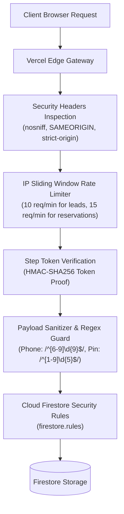

# Focus Academy — Full-Stack Security & Authorization Review

**Document ID:** FA-SEC-2026.1  
**Review Standard:** OWASP Top 10 Web Application Security & Cloud Firestore Rule Enforcement  

---

## 1. Security Architecture & Threat Model

---

## 2. Security Controls & Implementations

### 2.1 Cloud Firestore Security Rules (`firestore.rules`)
- **Public Surface:** Public read access is strictly confined to the `/batches` collection. No other collection can be read without authenticated administrator credentials.
- **Client Write Lockdown:** Public client-side writes to `/leads` and `/reservations` are forbidden (`allow create: if false;`). Inquiries and seat holds must be processed through backend serverless handlers where rate limits and sanitizers are enforced.
- **Role Hierarchies:**
  - `isOwner()`: Root administrator accounts (`admin@focusacademyperambalur.com`, `director@focusacademyperambalur.com`).
  - `isAdministrator()`: Owner + verified academy emails (`principal@focusacademyperambalur.com`, etc.).
  - `isFeeManager()`: Administrator + coordinator accounts (`coordinator@focusacademyperambalur.com`).
- **Audit Immutability:** `/audit_logs` records are append-only. Updates and deletions are forbidden (`allow update, delete: if false;`).
- **Payment Integrity:** `/payments` collection requires strict schema validation: `amount is number && amount > 0`. Updates can only affect reversal metadata keys (`isReversed`, `reversed`, `reversalReason`, `reversedBy`, `reversedAt`). Deletions are forbidden.

### 2.2 Serverless Endpoint Defense (`api/`)
- **Rate Limiting:** Sliding-window rate limiters backed by Firestore timestamps protect `/api/leads` (max 10 submissions/minute/IP), `/api/batches` (max 15 reservations/minute/IP), and `/api/session` (max 40 transitions/minute/IP).
- **Honeypot Traps:** Reject submissions containing populated honeypot fields (`website_url`, `faxNumber`, `company_fax`).
- **Payload Size Caps:** Reject payloads exceeding 8192 bytes (HTTP 413) to prevent resource exhaustion attacks.
- **Hashed Session Tokens:** Admission step transitions are cryptographically signed using HMAC-SHA256 with `SESSION_SECRET`. Clients cannot forge advancement to Step 5 without completing Step 1.

### 2.3 Sibling Data Isolation
- To protect student privacy when multiple siblings enroll from the same family phone, `registerStudent` in `AppContext` and `lookupProfile` in `StudentDetailsPage` enforce composite identity hashing (`phone + studentName`). Entering a phone number alone never displays another child's full name without confirmation.

### 2.4 HTTP Response Headers (`vercel.json`)
The following defensive response headers are enforced across all application routes:
- `X-Content-Type-Options: nosniff` (Prevents MIME-type sniffing).
- `X-Frame-Options: SAMEORIGIN` (Mitigates clickjacking attacks).
- `X-XSS-Protection: 1; mode=block` (Blocks cross-site scripting reflections).
- `Referrer-Policy: strict-origin-when-cross-origin` (Protects query string privacy on outbound external links).
- `Permissions-Policy: camera=(), microphone=(), geolocation=()` (Disables unnecessary device hardware access).

---

## 3. Environment Variable Safety
- **Public Variables:** Only non-sensitive public configuration keys are prefixed with `VITE_` (e.g., `VITE_FIREBASE_API_KEY`, `VITE_FIREBASE_PROJECT_ID`).
- **Private Variables:** Privileged server keys (`FIREBASE_SERVICE_ACCOUNT`, `SESSION_SECRET`, `WHATSAPP_CLOUD_API_TOKEN`) are strictly scoped to the serverless runtime and are never bundled into client-side JavaScript.
