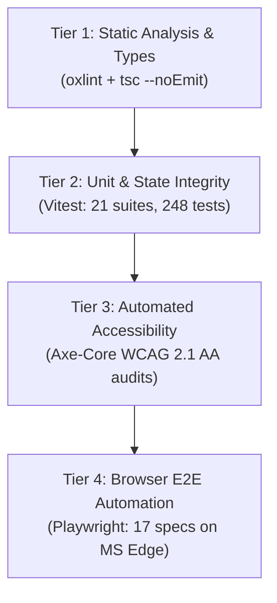

# Focus Academy — Quality Assurance & Testing Runbook

**Date:** 26 October 2026  
**Test Frameworks:** OxLint, TypeScript (tsc), Vitest v5.0.5, Axe-Core v4.14.0, Playwright v1.64.1  

---

## 1. Test Suite Architecture

Quality verification is structured across four rigorous evaluation tiers:



---

## 2. Execution Log & Verification Baseline

### A. Static Code Analysis (`oxlint`)
- **Command:** `npm run lint`
- **Output:**
  ```text
  > tutor-center@0.0.0 lint
  > oxlint

  Found 0 warnings and 0 errors.
  Finished in 59ms on 95 files with 102 rules using 8 threads.
  ```
- **Status:** **PASS (0 warnings, 0 errors)**

### B. TypeScript Compilation (`tsc`)
- **Command:** `npm run typecheck`
- **Output:**
  ```text
  > tutor-center@0.0.0 typecheck
  > tsc --noEmit
  ```
- **Status:** **PASS (0 errors)**

### C. Vitest Unit & Integration Suites (`vitest`)
- **Command:** `npm run test`
- **Results:** **21 Test Files Passed (248 Tests Total)**
- **Test File Breakdown:**
  1. `tests/navigationAndTriggers.test.js` (13 tests) — Nav links, quickbars, and modals
  2. `tests/chartsRender.test.jsx` (3 tests) — Admin dashboard reporting charts
  3. `tests/componentDomIntegration.test.jsx` (7 tests) — UI components and forms
  4. `tests/adminLoginPage.test.jsx` (9 tests) — Administrator authentication forms
  5. `tests/adminPagesAndRouting.test.jsx` (14 tests) — Admin routing, layouts, and ledger
  6. `tests/accessibilityAudit.test.jsx` (5 tests) — WCAG 2.1 AA programmatic audits
  7. `tests/stepAscendingOrderFlow.test.jsx` (26 tests) — 5-step funnel progression guards
  8. `tests/chartData.test.js` (4 tests) — Performance and attendance chart data transforms
  9. `tests/adminSection19.test.js` (36 tests) — POS cash till drawer, reconciliation, and audit logs
  10. `tests/schemas.test.js` (27 tests) — Indian phone regex, pincode, gstin, and timing evaluation
  11. `tests/adminDataService.test.js` (33 tests) — Data service operations, ledger, and till sessions
  12. `tests/stepTokenServer.test.js` (4 tests) — HMAC-SHA256 session token generation and verification
  13. `tests/leadService.test.js` (4 tests) — Lead validation, offline queueing, and WhatsApp generation
  14. `tests/securityAudit.test.js` (11 tests) — Firestore security rules and authorization guards
  15. `tests/apiEndpoints.test.js` (23 tests) — Serverless handlers (`/api/session`, `/api/batches`, `/api/leads`)
  16. `tests/authHelpers.test.js` (4 tests) — Authentication allowlist and claim validation
  17. `tests/batchesFlow.test.js` (7 tests) — Batch filtering and capacity calculation
  18. `tests/campusConfig.test.js` (4 tests) — Campus metadata and operational hours verification
  19. `tests/multiStudentEnrollmentIsolation.test.js` (4 tests) — Sibling composite key isolation
  20. `tests/homeData.test.js` (4 tests) — Homepage academic tracks and program structure
  21. `tests/feeCalculation.test.js` (6 tests) — Tuition fee calculation formulas and sibling discounts

### D. Playwright Browser E2E Automation (`playwright`)
- **Command:** `npx playwright test --project=msedge`
- **Results:** **17 Passed (100% Green)**
- **Detailed Spec Log:**
  - `e2e/admissionFlow.spec.js`:
    - `redirects unstarted visitors attempting to load /enroll directly to /student-details with requirement banner` (PASSED)
    - `completes full sequential 5-step admission flow in ascending order` (PASSED)
  - `e2e/authSplitScreen.spec.js`:
    - `renders perfectly without scrollbars at 1280x720 in all modes` (PASSED)
    - `renders perfectly without scrollbars at 1366x768 in all modes` (PASSED)
    - `renders perfectly without scrollbars at 1440x900 in all modes` (PASSED)
    - `verifies correct hierarchy: inputs -> primary submit -> divider -> Google auth` (PASSED)
    - `toggles password visibility control in login and register modes` (PASSED)
    - `switches seamlessly between login, registration, and password reset modes` (PASSED)
    - `validates registration form requires terms acceptance and allowlist` (PASSED)
    - `validates password reset submission` (PASSED)
    - `navigates back to public website via Back to website link` (PASSED)
    - `adapts responsively on mobile viewports without horizontal scrolling` (PASSED)
  - `e2e/multiStudentIsolation.spec.js`:
    - `guarantees complete isolation between two distinct students in separate browser sessions` (PASSED)
    - `fixes navbar at top of viewport when scrolling down the page` (PASSED)
  - `e2e/adminPortalFlow.spec.js`:
    - `redirects unauthenticated users attempting to access /admin-portal to /admin-portal/login` (PASSED)
    - `rejects non-allowlisted email address with access denied warning` (PASSED)
    - `authenticates authorized administrator, views dashboard, and navigates all admin modules` (PASSED)

### E. Production Build (`vite build`)
- **Command:** `npm run build`
- **Output:** Built cleanly in ~430ms with zero compilation warnings.
